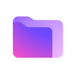
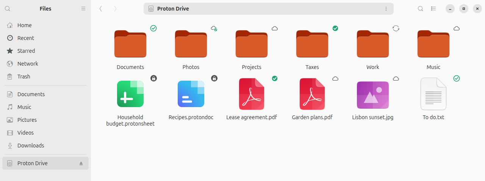
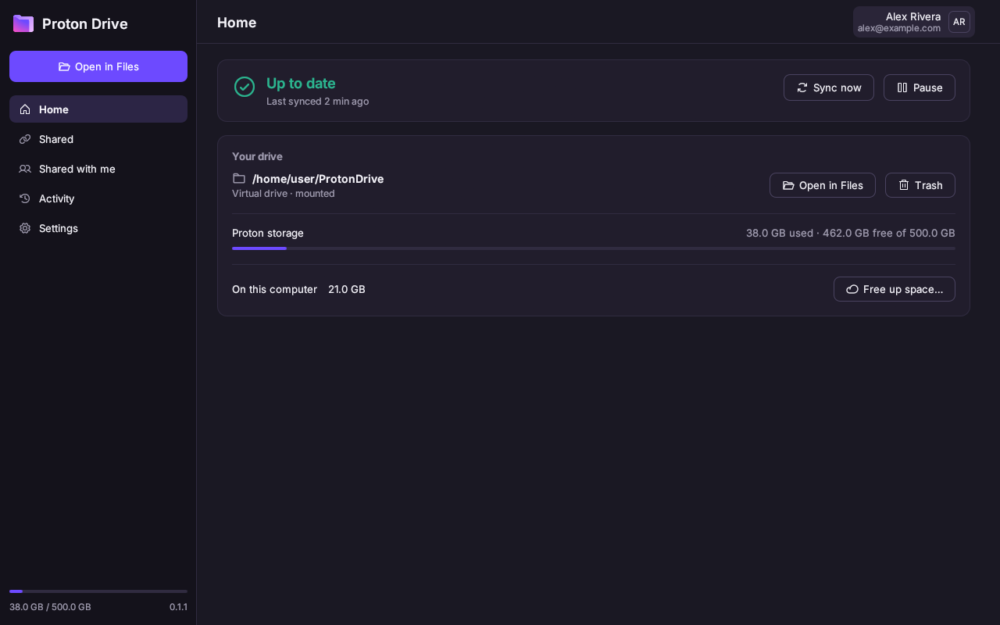
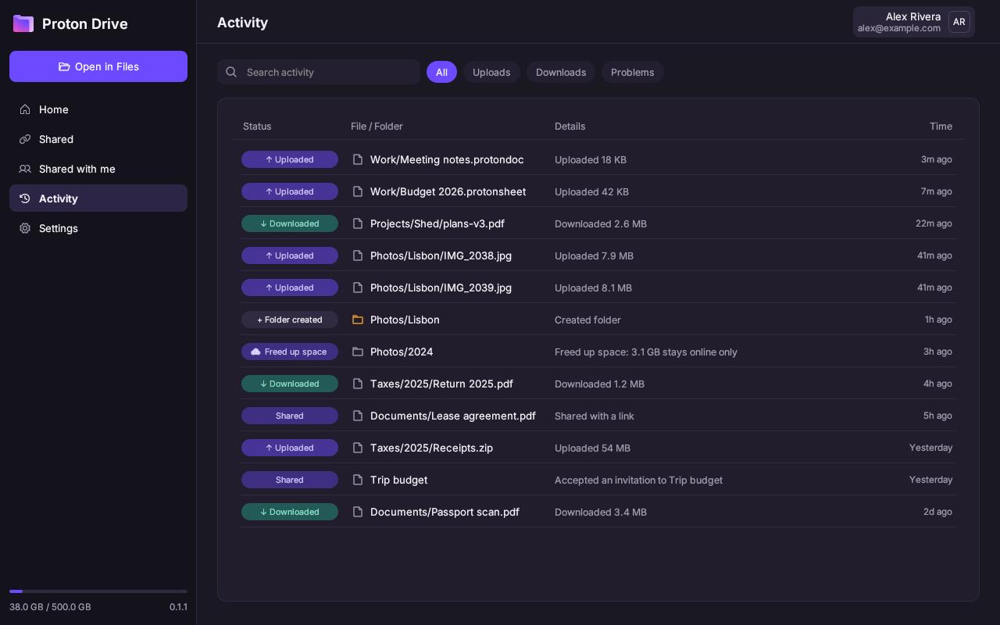
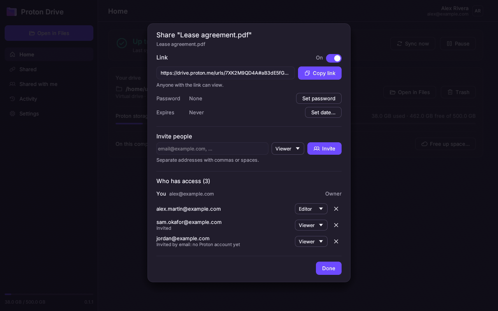
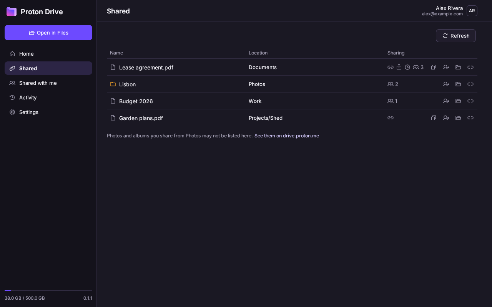
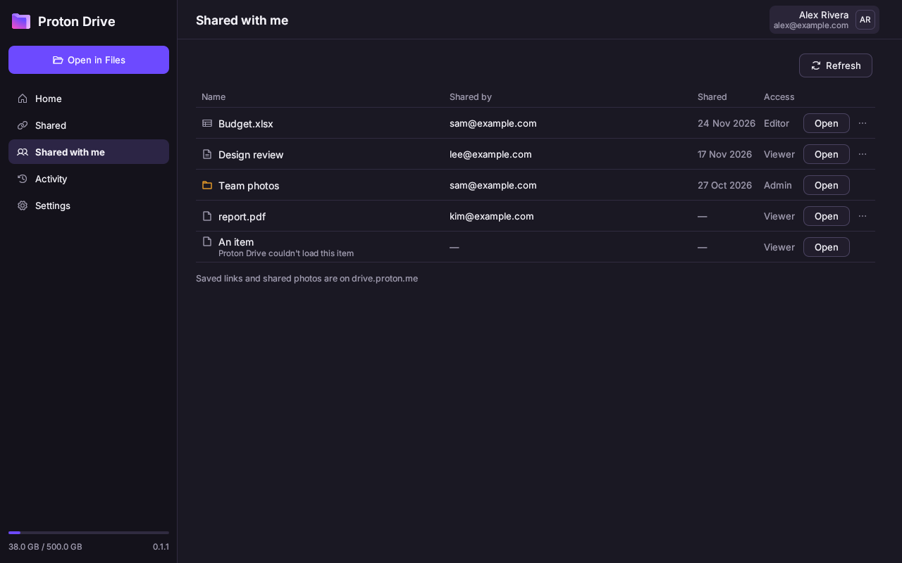
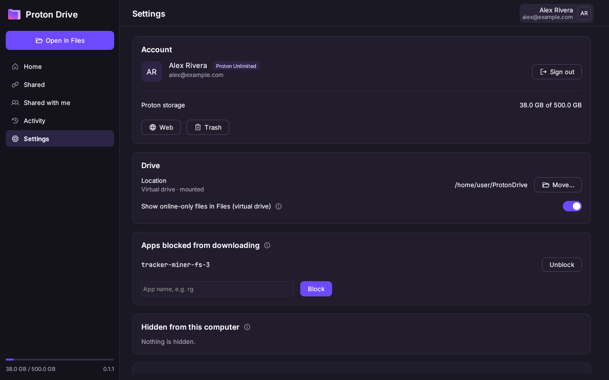

# Proton Drive for Linux

**An unofficial desktop app for Proton Drive.** Your whole Drive in Files, with files that download only when you
open them, two-way sync, and sharing, built on Proton's own Drive SDK.

Proton Drive in GNOME Files: an illustration with made-up files. The icons show what's kept on this computer,
downloaded, online only, or syncing.

> **Unofficial.** Not made, endorsed or supported by Proton AG. "Proton" and "Proton Drive" are trademarks of
> Proton AG. This is early software that syncs your files: keep backups.

## What it does

**Your Drive in Files**
- **Everything is listed:** all of your Proton Drive shows in Files' sidebar. Files that aren't on this computer take
  no space and download when an app opens them.
- **Status icons** on every file: kept on this device, downloaded, online only, syncing, or needs attention.
- **The right-click menu:** **Always keep on this device**, **Free up space**, **Hide from this computer**,
  **Share…** and **Copy Link**.
- **Proton Docs and Sheets** show up as files that open in your browser.

**Sync you can trust**
- **Two-way:** changes on either side arrive within seconds.
- **It never deletes or overwrites anything in your Proton Drive** unless you deleted or changed it yourself. When it's
  unsure, it keeps both copies.
- **Conflicts** are kept as copies, side by side.

**An app and a tray menu**
- **Home:** whether you're in sync, and what needs you.
- **Shared:** your share links (with passwords and expiry dates) and the people you've invited.
- **Shared with me:** invitations to accept, and what others share with you.
- **Activity:** what was synced.
- **Settings:** your account, the drive, and apps blocked from downloading.
- **The tray** shows the same status.

**Private by design**
- **Sign-in:** you sign in on Proton's own page in your browser, so the app never sees your password.
- **Encryption** happens on your computer, through Proton's Drive SDK, as in Proton's own apps.
- **The app talks only to Proton.** It sends no analytics or crash reports.

## Install

You need a 64-bit Intel or AMD PC with Ubuntu 22.04, Debian 12 or newer (or any distribution with glibc 2.35 or newer),
and a Proton account with Drive. Download your package from the
[releases page](https://github.com/kosidhar/proton-drive/releases), then:

| System | Package | Install it with |
| :--- | :--- | :--- |
| Ubuntu, Debian, Mint, Pop!_OS | `.deb` | `sudo apt install ./kosidhar-protondrive-<version>-linux-amd64.deb` |
| Fedora | `.rpm` | `sudo dnf install ./kosidhar-protondrive-<version>-linux-x86_64.rpm` |
| Arch, Manjaro | `.tar.gz` | `makepkg -si` with the [PKGBUILD](packaging/linux/arch/PKGBUILD) |
| Anything else | `.AppImage` | `chmod +x` it, then run it |
| Anything else, installed | `.tar.gz` | `./install.sh --user` from the extracted folder |

Then open **Proton Drive** from your app menu and sign in. Restart Files once (`nautilus -q`, or log out and back in)
so it shows the status icons and the right-click menu. From then on, Proton Drive starts when you log in.

[docs/INSTALL.md](docs/INSTALL.md) has the details for each package, and how to uninstall safely.

## Works best with

| Desktop | What you get |
| :--- | :--- |
| GNOME (Files) | Everything: the drive, the status icons and the right-click menu |
| Cinnamon (Nemo), KDE Plasma (Dolphin) | The drive and the app, with a smaller right-click menu (Sync Now, Status & Settings). Nemo's check marks don't show the real status yet (#530) |
| Anything else | The drive as a folder, the app, and the tray icon where the desktop supports one |

It's used every day on GNOME. Other desktops are less tested, so reports are very welcome.

## Screenshots

<table>
  <tr>
    <td align="center" width="50%"> <b>Home</b></td>
    <td align="center" width="50%"> <b>Activity</b></td>
  </tr>
  <tr>
    <td align="center" width="50%"> <b>Sharing</b></td>
    <td align="center" width="50%"> <b>Shared</b></td>
  </tr>
  <tr>
    <td align="center" width="50%"> <b>Shared with me</b></td>
    <td align="center" width="50%"> <b>Settings</b></td>
  </tr>
</table>

The app's screenshots show made-up data. `scripts/readme-screenshots.sh` regenerates them, and
`scripts/files-illustration.sh` redraws the Files illustration.

## How it works

- **A background service** (`protondrive daemon`, TypeScript on [Bun](https://bun.sh)) does the syncing through
  Proton's official [Drive SDK](https://github.com/ProtonDriveApps/sdk). The SDK handles all of the encryption.
- **The app** (`protondrive-gui`, Rust and [egui](https://github.com/emilk/egui)) and the tray talk to the service
  locally.
- **The virtual drive** is a small FUSE helper (`protondrive-vfs`, Rust). It lists everything, and asks the service to
  download a file when an app opens it.
- **The Files integration** is a Nautilus extension that asks the service for each file's state.

Four rules come before everything else:
- nothing in your Proton Drive is trashed or overwritten unless you deleted or changed it;
- the sync records are written before the files;
- a missing local file is never taken as a delete when its folder may be gone;
- when in doubt, both copies are kept.

## Status

This is an early pre-release (`0.x`). It has been in daily use on a real account since early November 2026. Each
release's `.deb` is installed and started on clean Ubuntu 22.04 and Debian 12 before it's published, and about 2,500
automated tests run on every change. It was built with a lot of help from AI coding tools; every change goes through
those tests and a review.

**Not there yet:**
- version history (#515);
- streaming large files (#516);
- backing up other folders as a computer (#514);
- an ARM build;
- shared items in the drive itself.

The [open issues](https://github.com/kosidhar/proton-drive/issues) list the rest.

## Documentation

| | |
| :--- | :--- |
| [Installing](docs/INSTALL.md) | Every package, starting at login, uninstalling safely, building the packages |
| [Using it](docs/USER_GUIDE.md) | The drive, the icons and right-click menu, deleting, the app and the tray |
| [Command line](docs/CLI.md) | Every `protondrive` command |
| [Changelog](CHANGELOG.md) | What changed in each release |
| [Contributing](CONTRIBUTING.md) | Building from source, the checks, and the project's rules |
| [Security](SECURITY.md) | Reporting a security problem privately |

## License

MIT, see [LICENSE](LICENSE). Third-party parts are listed in [THIRD_PARTY_NOTICES.md](THIRD_PARTY_NOTICES.md).
